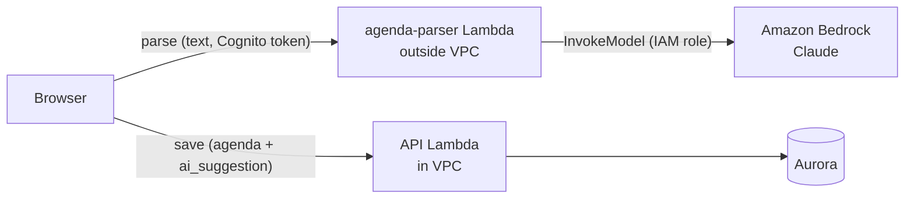

# 0006. LLM-based agenda parsing ("Paste an agenda")

Status: accepted · Date: 2026-10-27

## Context
Agendas arrive as free text (an email, a chat message, notes), not as a form. Users should be
able to paste that text and get a pre-filled agenda form that they check and save.

Constraints:
- The API runs in a VPC with **no NAT gateway and no interface endpoints**, so it costs $0 when idle.
- **Every call costs money** (tokens), and the result is non-deterministic and can be wrong.
- The pasted text comes from outside (anyone can send an email) and must be treated as data,
  not as instructions (prompt injection).

## Decision
- **Model:** Claude on Amazon Bedrock through the Anthropic Messages API. The model ID is
  configuration (`PARSER_MODEL`), default `anthropic.claude-opus-5-5`; Haiku 5.5 is ~40x cheaper
  and is evaluated on the same five test inputs before choosing.
- **API used in this project:** the Claude 5.x models were not available to this AWS account
  (`not available for this account` on both APIs, although the model catalog showed them as
  authorized), so the deployed parser uses the **Converse API** (`PARSER_API=converse`) with
  `us.anthropic.claude-haiku-4-5-20251001-v1:0`. The code supports both APIs behind one function;
  switching back is a configuration change (`PARSER_API=messages`, `PARSER_MODEL=anthropic.claude-...`).
  The trade-off from the lab: Converse is provider-neutral (the model ID is the only Claude-specific
  part), the Messages API gets new Claude features first.
- **Structured output:** the model answers by calling one tool, `record_agenda`, whose schema is
  the Pydantic `ParsedAgenda`. Bedrock's Messages API has no structured-outputs mode and Opus 5.5
  does not accept a forced tool choice, so the output is **validated in code**: one retry with the
  validation error, then a clear error. Empty fields stay empty; the prompt forbids guessing.
- **Where it runs:** a separate Lambda (`meetings-ai-parser`, same image, different command)
  **outside the VPC** behind a function URL. It needs no database, so it reaches Bedrock over the
  internet with no NAT and no endpoint, and costs nothing while unused.
- **Who writes:** the model never writes. The browser shows a pre-filled form; **Save goes through
  the existing authenticated API** (`PUT /api/meetings/{id}/agenda`) with its validation. The
  parser has no database access and no write tools.
- **Authentication and limits:** the parser verifies the same Cognito ID token (401 otherwise),
  rejects text over 10,000 characters (413) before any model call, and an AWS Budgets alarm at
  $5/month emails the owner.
- **Quality signal:** the save request also sends what the model suggested, with model and prompt
  version; the API stores it in `meeting_agendas.ai_suggestion` (JSONB) next to the final agenda.

Updated C4 level 2 diagram: `docs/architecture-container-ai.png` (source: `docs/make_diagram.py`).

## Alternatives considered
- **Call Bedrock from the API through a VPC interface endpoint.** Lost: ~$7.30/month per
  endpoint breaks "$0 when idle", and the API would get a slow, costly dependency it does not
  need; the parser needs no data from the database.
- **Claude API directly instead of Bedrock.** Lost: needs an API key to store and rotate (Bedrock
  uses the Lambda's IAM role), billing outside the AWS account (no Budgets, tags or CloudTrail),
  and the traffic leaves AWS. Its only advantage, newest features first, is not needed here.
- **A regular-expression parser.** Lost: free and deterministic, but it only handles the formats
  its author thought of; real agendas vary in layout and language (uk/en), and relative dates
  ("by Friday") need understanding. It stays useful as a baseline for the evaluation.

## Consequences
- **Cost:** about 1,000-1,500 input and 200-500 output tokens per parse: roughly $0.01 with Opus
  5.5 and $0.0003 with Haiku 5.5 (see the CloudWatch log line for the exact figure).
- **Logged** (one JSON line per parse, `/<PROJECT_NAME>/ai-parser` log group): user id, model, prompt
  version, input/output tokens, latency, cost, outcome. The pasted text itself is **not** logged.
- **Bedrock down or throttled:** the parser returns 502/429, the UI shows "busy / unavailable" and
  the user types the agenda by hand; the rest of the app is unaffected (different function, no
  shared dependency).
- **Wrong answers are possible** with a 200 status. The UI marks suggested fields, the user
  confirms, and corrections are measured through `ai_suggestion` vs the saved agenda.
- **Prompt injection** cannot be fully prevented; damage is limited because the parser has no
  tools or data, its output is schema-validated, rendered as text, and only a person's Save writes.
- The Bedrock IAM permission is `Resource: "*"` for now; it should be narrowed to one model.
