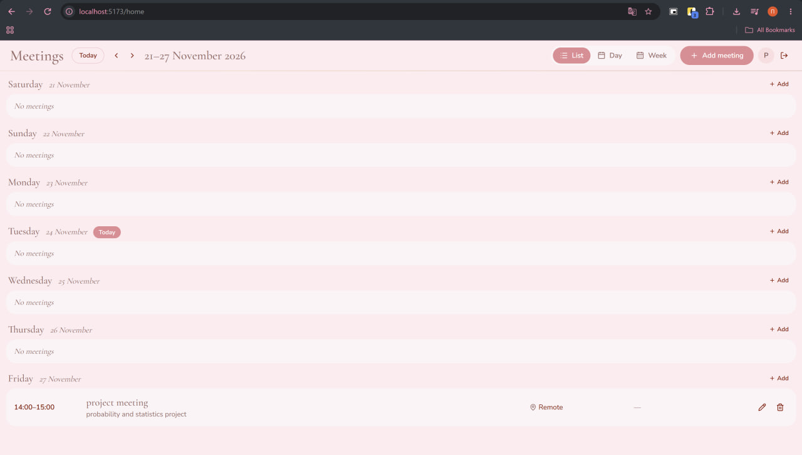
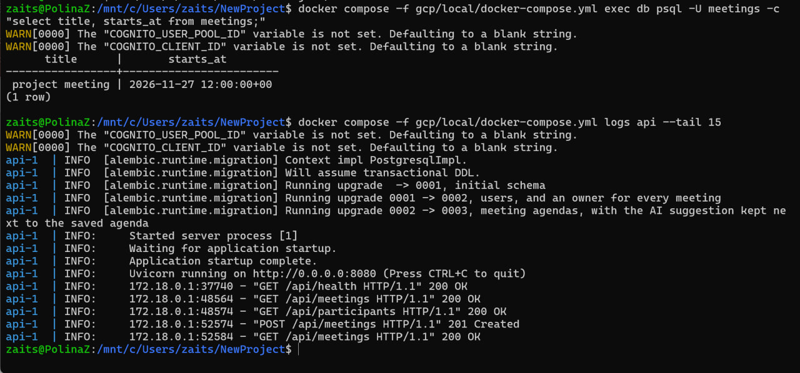

# Лабораторна 9: One project, two clouds: Spry on Google Cloud

Я обрала шлях без акаунта Google Cloud (Google не дозволив відкрити біллінг-акаунт).

## 1. Конфігурація `gcp/` і ADR

Вивід `terraform init` і `terraform validate` у `gcp/`:

```
$ terraform init -backend=false
Initializing provider plugins...
- Reusing version 7.46.2 of hashicorp/google from the dependency lock file
- Reusing version 3.9.1 of hashicorp/random from the dependency lock file
- Using previously-installed hashicorp/google v7.46.2
- Using previously-installed hashicorp/random v3.9.1

Terraform has been successfully initialized!

$ terraform validate
Success! The configuration is valid.
```

## 2. Застосунок на умовах Cloud Run, локально

`backend/Dockerfile.cloudrun` (без Lambda-адаптера, `PORT=8080`) працює поруч з локальним PostgreSQL 16 (`gcp/local/docker-compose.yml`).





На другому скріні: запис зустрічі в PostgreSQL (`2026-11-27 12:00 UTC`, у застосунку це 14:00 за Києвом), міграції `alembic` 0001 → 0003, `uvicorn` на `0.0.0.0:8080`, `GET /api/health` і `GET /api/meetings` повертають 200, `POST /api/meetings` повертає 201.

## 3. Таблиця вартості: ядро Spry, один місяць

Припущення: ціни на вимогу, 730 годин на місяць, AWS у `us-east-1`, GCP у `us-central1`. API і фронтенд не виходять за безкоштовні ліміти (Lambda, Cloud Run, CloudFront Free, Firebase Hosting free), тому вирішує база даних. Aurora Serverless v2: $0,12 за ACU-годину, діапазон 0–1 ACU, у стані «працює» щонайменше 0,5 ACU, тобто $0,06 за годину; після 5 хвилин простою (як у README проєкту) Aurora засинає і бере гроші лише за сховище. Cloud SQL `db-f1-micro`: $0,0105 за годину, 10 ГБ SSD по $0,17 = $1,70 на місяць.

| Рядок | AWS | Google Cloud |
|---|---|---|
| Фронтенд + CDN + HTTPS | CloudFront Free → $0 | Firebase Hosting → $0 |
| API | Lambda → $0 | Cloud Run, до нуля → $0 |
| Обчислення бази | Aurora на паузі → $0 | Cloud SQL працює → $7,67 |
| Сховище бази | ~1 ГБ × $0,10 → $0,10 | 10 ГБ × $0,17 → $1,70 |
| Реєстр, секрети, логи | кілька центів | у безкоштовному ліміті |
| **Разом, ніхто не користується** | **≈ $0,30** | **≈ $9,40, або ≈ $1,70 із зупиненою базою** |

Формули ($h$ годин роботи бази на місяць, $n$ сесій, $t = 5$ хв до паузи):

$$C_{\text{AWS}} = 0{,}06\left(h + \frac{n\,t}{60}\right) + 0{,}30 \qquad C_{\text{GCP}} = 0{,}0105\,h + 1{,}70$$

Точка беззбитковості між Aurora (0,5 ACU) і Cloud SQL, що працює завжди:

$$h_{\text{eff}} = \frac{9{,}37 - 0{,}30}{0{,}06} \approx 151 \text{ год на місяць}$$

| Профіль | AWS | Google Cloud |
|---|---|---|
| Ніхто не користується | **≈ $0,30** | $9,37 (працює) або $1,70 (зупинена) |
| Демо в класі (10 × 2 год): $h=20,\ n=10$ | **≈ $1,55** | $9,37 або ≈ $1,91 (20 год × $0,0105 + $1,70) |
| Робочі години (8 год × 22 дні): $h=176,\ n=22$ | ≈ $10,97 | **$9,37** або **≈ $3,55** (за розкладом) |
| Цілодобово: $h=730$ | ≈ $44 (0,5 ACU) до ≈ $88 (1 ACU) | **$9,37** (або ≈ $27,25 з `db-g1-small`) |

Для «ніхто» і «демо» дешевша AWS, для «робочих годин» і «цілодобово» дешевша Google Cloud. У всіх чотирьох випадках вирішує один рядок: **обчислення бази даних**. Aurora платить за ACU-години і не бере грошей, коли спить, а Cloud SQL бере фіксовану ціну за кожну годину, коли екземпляр увімкнений.

**Пастка на боці GCP.** Cloud SQL ніколи не засинає: екземпляр, що лишився увімкненим після лаби, коштує ≈ $9,4 на місяць, а зупинений усе одно платить за сховище ($1,70). Менші пастки: Cloud Run з мінімальною кількістю екземплярів більше нуля, резервні копії, висока доступність. У `gcp/` вони вимкнені (`backup` вимкнено, `availability_type = "ZONAL"`, `min_instance_count = 0`, `cpu_idle = true`).

## 4. Демо без Google Cloud

**Колаб** (DuckDB замість BigQuery, Tesseract і EasyOCR замість Vision API, Qwen3-VL через Ollama замість Document AI, власний промпт для JSON): https://colab.research.google.com/drive/1POtylpB87eVkktvV1jnoAcmdynIIWvdw

Запит DuckDB над публічним Parquet (NYC yellow taxi, січень 2024): поїздки і середній тариф по годинах доби.

| hour | trips | avg_fare |
|---:|---:|---:|
| 0 | 79094 | 19.20 |
| 1 | 53627 | 17.53 |
| 2 | 37517 | 16.48 |
| 3 | 24811 | 18.15 |
| 4 | 16742 | 22.52 |
| 5 | 18764 | 26.62 |
| 6 | 41429 | 21.65 |
| 7 | 83719 | 18.54 |
| 8 | 117209 | 17.65 |
| 9 | 128970 | 17.71 |
| 10 | 138778 | 17.75 |
| 11 | 150542 | 17.43 |
| 12 | 164559 | 17.48 |
| 13 | 169903 | 18.12 |
| 14 | 182898 | 18.95 |
| 15 | 189359 | 18.77 |
| 16 | 190201 | 19.12 |
| 17 | 206257 | 17.84 |
| 18 | 212788 | 16.72 |
| 19 | 184032 | 17.29 |
| 20 | 159989 | 17.70 |
| 21 | 160888 | 17.95 |
| 22 | 143261 | 18.69 |
| 23 | 109287 | 19.76 |

**Looker Studio**, дашборд за OWID CO₂ (лінійні графіки для України, Польщі та Канади, геокарта викидів на душу населення, топ-10 країн за викидами у 2025 році, елемент керування за кодом країни): https://datastudio.google.com/s/oP3BgW5wEuE

Копія дашборда у PDF: `img/looker-dashboard.pdf`. Що я помітила в даних: країна з найбільшими викидами CO₂ не обов'язково найвища за викидами на душу населення; в Україні після 1984 року викиди стрімко падають, але пік був вищим, ніж у Польщі та Канади.

## 5. Три речення

1. Обидва входи дали 8 з 9 полів і помилилися в тому самому полі `seller` («Kozelnyska» замість «Kozelnytska»; у Markdown ця помилка з'явилася ще на кроці 4), тому за точністю нічия, але Markdown трохи кращий для моделі, бо підписи там уже стоять поруч зі значеннями, а таблиця розібрана на рядки, тоді як з картинки модель видала шумне число `120.0000000000000142`.
2. Розділ 4 тривав 289 секунд (близько 4,8 хв), розділ 5 тривав 225 секунд (113 с для A і 112 с для B, близько 3,8 хв), усе на CPU (безкоштовний Colab без GPU).
3. За Document AI я б платила, коли документів багато, формат повторюється і потрібні однакова відповідь, оцінка впевненості по кожному полю, таблиці на кількох сторінках і SLA; для кількох довільних документів вистачає загальної моделі.
